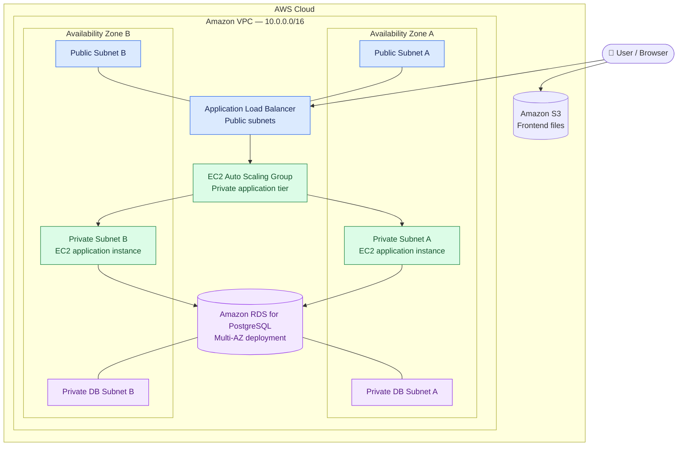

# 👑 LuxeCrown | Three-Tier AWS Cloud Architecture

<p align="center">
  <strong>From application code to cloud infrastructure.</strong><br/>
  Designing and deploying a scalable, highly available three-tier web application on AWS.
</p>

<p align="center">
  ☁️ AWS Cloud &nbsp; • &nbsp; 🏗️ Three-Tier Architecture &nbsp; • &nbsp; 🔐 Network Isolation &nbsp; • &nbsp; 📈 Auto Scaling
</p>

---

## 🌐 Project Overview

**LuxeCrown is a cloud deployment project focused on hosting a three-tier salon and barbershop booking application on Amazon Web Services.**

The core of this project is the infrastructure: designing a VPC, distributing resources across multiple Availability Zones, separating public-facing components from private application and database resources, and configuring load balancing, automatic scaling, and managed database availability.

The objective was to go beyond simply running an application on a server and understand how its infrastructure components work together to support availability, scalability, and controlled network access.

## 🏗️ Architecture

The solution uses a custom Amazon VPC with six subnets across two Availability Zones.

- **Presentation tier:** Static frontend files hosted in Amazon S3.
- **Application tier:** Node.js and Express backend hosted on private EC2 instances, with traffic distributed by an Application Load Balancer and capacity managed through an Auto Scaling group.
- **Data tier:** Amazon RDS for PostgreSQL configured for Multi-AZ deployment.

### Architecture diagram



<p align="center"><em>Logical architecture of the deployed environment.</em></p>

### Architecture image

```markdown

```

Replace `docs/architecture.png` with the actual relative path and filename of your diagram. The Mermaid diagram above already renders directly in GitHub, so an external image is optional.

## ☁️ AWS Infrastructure

| AWS component | Implementation and purpose |
|---|---|
| **Amazon VPC** | Custom virtual network using `10.0.0.0/16`. |
| **Six subnets** | Two public and four private subnets distributed across two Availability Zones. |
| **Internet Gateway** | Provides internet connectivity for resources with the appropriate public routing and security configuration. |
| **Route tables** | Control traffic routing between subnets and the relevant network destinations. |
| **Application Load Balancer** | Provides the public application entry point and distributes incoming requests to the application tier. |
| **EC2 Auto Scaling group** | Manages the application instances and supports scaling based on the configured scaling policies. |
| **Amazon EC2** | Hosts the Node.js and Express backend in private subnets. |
| **Amazon RDS for PostgreSQL** | Stores relational application data and uses Multi-AZ deployment for database availability. |
| **Amazon S3** | Stores the static frontend assets. |

## 🔐 Network Design & Security

The infrastructure separates public-facing access from application processing and data storage.

**Public subnets**
- Host the Application Load Balancer.
- Provide the public-facing entry point to the backend application.

**Private application subnets**
- Host the EC2 application instances.
- Keep application servers from requiring direct public inbound access.
- Allow application traffic through the intended load-balancing and security-group configuration.

**Private database subnets**
- Place database resources within the private network.
- Support restricted database connectivity from authorized application resources.
- Provide subnet placement across Availability Zones for the Multi-AZ database configuration.

Security groups and route tables form part of the access-control and network-routing design. The objective is to expose only the required entry points while keeping application and database resources appropriately isolated.

## 📈 Scalability & Availability

The architecture incorporates two important AWS capabilities.

### Application Load Balancing

The Application Load Balancer receives incoming application requests and distributes traffic to registered application instances. This provides a central entry point and supports the use of multiple backend instances.

### EC2 Auto Scaling

The Auto Scaling group manages the EC2 application tier according to its configured capacity and scaling policies. It can add or remove instances in response to the configured scaling conditions.

### Multi-AZ database deployment

Amazon RDS for PostgreSQL is configured for Multi-AZ deployment to improve database availability through a standby deployment in another Availability Zone. Multi-AZ is primarily an availability and failover capability; it should not be confused with automatic read scaling.

Together, these components demonstrate how a web application can be structured to reduce dependence on a single application instance or Availability Zone.

## 🛠️ Technology Stack

- **Cloud platform:** Amazon Web Services (AWS)
- **Networking:** Amazon VPC, public and private subnets, route tables, Internet Gateway
- **Compute:** Amazon EC2
- **Traffic distribution:** Application Load Balancer
- **Scaling:** EC2 Auto Scaling
- **Database:** Amazon RDS for PostgreSQL
- **Frontend hosting:** Amazon S3
- **Backend runtime:** Node.js and Express
- **Frontend technologies:** HTML, CSS, JavaScript
- **Payment integration code:** Safaricom M-Pesa STK Push

## 🎯 My Contribution

My focus in this project was **AWS infrastructure configuration and application deployment**.

I worked on:

- Designing and configuring a custom VPC with six subnets across two Availability Zones.
- Separating public-facing resources from private application and database resources.
- Configuring route tables and network access.
- Deploying the backend to private EC2 instances.
- Configuring an Application Load Balancer to distribute application traffic.
- Configuring an EC2 Auto Scaling group for application capacity management.
- Setting up Amazon RDS for PostgreSQL with Multi-AZ deployment.
- Hosting the frontend assets in Amazon S3.
- Establishing connectivity between the application tier and the database.

The application code was provided by another developer. My contribution was focused on the cloud infrastructure and deployment rather than original application development.

## 💳 Application Context

LuxeCrown provides the application workload for this infrastructure project. Its functionality includes salon and barbershop services and appointment booking.

The codebase contains M-Pesa STK Push integration code. However, the frontend also contains simulated payment-success behaviour, and successful live payment processing has not been verified for this project.

## 🚀 Deployment Status

The AWS environment used for this project is currently inactive, and a live demonstration is not available.

The infrastructure described above reflects the components deployed for the project. CloudFront was not implemented and remains a potential future improvement for frontend content delivery.

## 🔭 Future Improvements

- Integrate Amazon CloudFront with a securely configured S3 origin.
- Automate infrastructure provisioning with Terraform.
- Introduce a CI/CD pipeline for repeatable deployments.
- Strengthen centralized monitoring, logging, and alerting.
- Test application scaling behaviour and database failover.
- Complete end-to-end verification of booking and payment workflows.

## 💡 What This Project Demonstrates

This project demonstrates practical experience with the infrastructure behind a cloud-hosted application: network design, public and private resource placement, load balancing, compute scaling, managed database availability, and static frontend hosting.

The goal is not merely to deploy a website, but to understand how AWS services work together to support a more resilient and scalable application architecture.

---

<p align="center">
  <strong>☁️ Designing infrastructure. Deploying applications. Building for scale.</strong>
</p>
